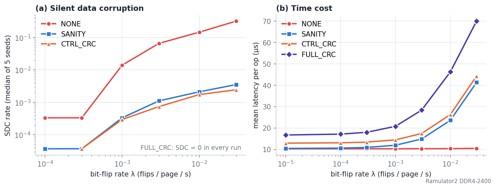
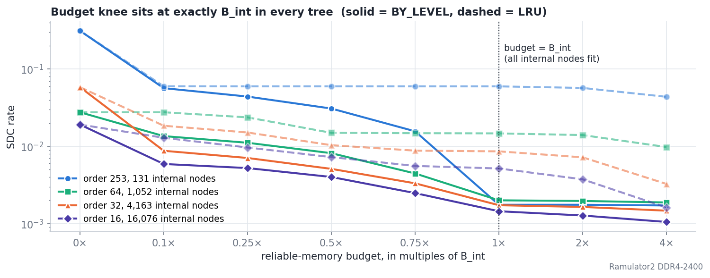
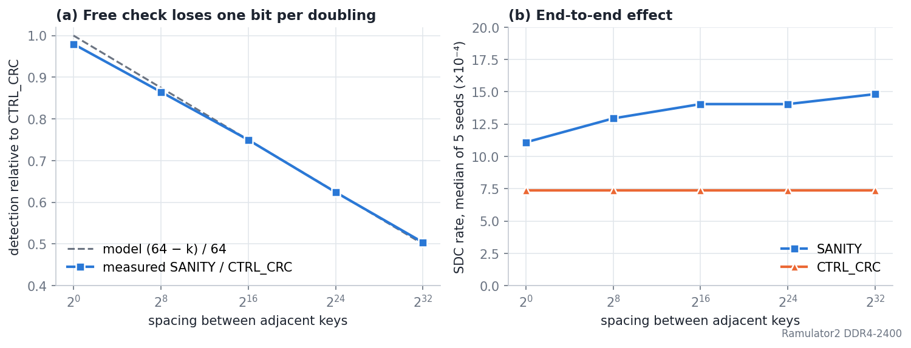
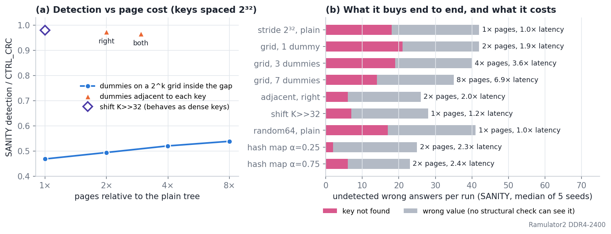

# B+ tree 不均等保護：DRAM bit flip 實驗

DRAM 的 bit flip 會在沒有任何警報的情況下損毀記憶體中的 B+ tree。本實驗量測損害落在哪裡、各種保護的效果與代價，結論是**保護應依節點層級與欄位角色分配**，而所需參數可以在部署前由 fan-out 與 key 分布算出。

**本頁數字全部來自 Ramulator2 後端**（cycle-accurate DDR4-2400）。先前以純 C++ DRAM 模型跑的版本，結論與本頁相同，圖表保留在 [results/figures/readme/](btree/b-tree_experiment/results/figures/readme/)。

- 論文格式完整版（目前仍為 C++ 模型的數字）：[results/paper/paper.html](btree/b-tree_experiment/results/paper/paper.html)
- 逐節詳細數據：[results/SUMMARY_dbscale.md](btree/b-tree_experiment/results/SUMMARY_dbscale.md)；Ramulator2 彙整表：[results/paper_r2/paper_tables.md](btree/b-tree_experiment/results/paper_r2/paper_tables.md)
- 程式架構、編譯與參數說明：[HARNESS.md](btree/b-tree_experiment/HARNESS.md)

## 實驗設定

| 項目 | 設定 |
|---|---|
| 系統 | B+ tree → DRAM cache → SSD。SSD 是正確資料的來源，偵測到損毀就從 SSD 重載 |
| DRAM 模型 | Ramulator2，DDR4-2400（DDR4_8Gb_x8），ECC 關閉 |
| 樹 | 4 KB page、order 253、1,000,000 keys、樹高 3、約 5,760 頁 |
| 工作負載 | 30,000 次操作，90% 搜尋、10% 插入 |
| 故障 | DRAM 內均勻 bit flip，預設 λ = 3×10⁻³ flips/page/s（比真實高約 10⁶ 倍以加速） |
| 指標 | **SDC**：搜尋回傳錯誤且全程無警報的比例；**時間**：每次操作平均延遲；**成本**：可靠記憶體與頁數 |
| 規模 | 1,412 次 run，每格 3–5 個 seed |

保護方案（λ = 3×10⁻³，5 seeds）：

| 方案 | 檢查內容 | 可靠記憶體 | SDC | 延遲 | 相對 NONE |
|---|---|---|---|---|---|
| NONE | 不檢查 | 0 | 5.9×10⁻² | 10.3 µs | — |
| SANITY | 節點結構：key 遞增、指標範圍等 | 0 | 1.1×10⁻³（中位數） | 14.8 µs | +44% |
| CTRL_CRC | SSD header、node header、keys、child pointers 的 CRC，不含 leaf values | 12 B/頁 | 7.6×10⁻⁴ | 17.4 µs | +69% |
| FULL_CRC | 整頁 CRC | 12 B/頁 | 0 | 28.4 µs | +175% |

CTRL_CRC 的時間成本是 FULL_CRC 的 39%。SANITY 的平均 SDC 是 3.8×10⁻³，被一個打中熱門內部節點的 seed 拉高（409 個錯誤答案，其餘 4 個為 17–35），所以表中列中位數。

## 主要成果

### 1. 損害會放大，而且集中在導航資訊（E1）

沒有保護時，一次 bit flip 平均讓 **20.7 個 key** 出錯，若損害只留在原地上限是 1 個。控制區只佔毀損事件的約三分之一，但只保護它（CTRL_CRC）就消除 **98.7%** 的損害，因為 internal node 的分隔點或指標壞掉時，每次經過的搜尋都會被導錯。



### 2. 可靠記憶體的最適預算 = 全部 internal node 的大小（E2）

預算以 B_int（剛好裝下全部 internal node 所需的位元組）為單位。四種樹的 internal node 從 131 到 16,076 個（相差 123 倍），**膝點全部落在 1.0×B_int**，再增加預算幾乎沒有效果。優先保留上層節點的 BY_LEVEL 在每個預算都贏 LRU，領先幅度隨 internal node 變多由 34 倍降到 3.6 倍：internal node 越多，LRU 自然留住的上層節點也越多。



### 3. 免費的結構檢查有可預測的盲區（E7）

SANITY 只檢查 key 是否遞增。key 間距為 2ᵏ 時，最低 k 個位元的翻轉不會越過鄰居，所以偵測率 ≈ **(64 − k)/64**，五個點誤差都在 2 個百分點內，看不到的正好是最低 k 個位元。CTRL_CRC 是對內容算 CRC，SDC 在五種間距下都是 7.6×10⁻⁴，不受影響。internal node 的分隔點間距 = 葉間距 × fan-out，所以即使 key 是連號，分隔點最低約 7 個位元仍看不到，而這正是每次搜尋都會讀的節點。



### 4. 把稀疏 key 變密：哪種做法划算（E7 延伸）

錯誤答案數為每 run 的中位數（約 27,000 次搜尋），只用 SANITY。

| 做法 | 偵測率 | 「找不到」 | 頁數 | 延遲 | 結論 |
|---|---|---|---|---|---|
| 不處理，間距 2³² | 0.47 | 18 | 1 倍 | 1.0 倍 | 基準 |
| 在 2ᵏ 格子上安插 dummy | 0.49 → 0.54 | 14–21 | 2–8 倍 | 1.9–6.9 倍 | 每加倍頁數只多約 1 個位元，端到端沒有改善 |
| 在每個 key 旁緊貼 dummy | 0.97 | 6 | 2 倍 | 2.0 倍 | 偵測率回來了，但樹變大抵銷部分效益 |
| 直接 key >> k 換算成連號 | 0.98（等同連號） | 7 | 1 倍 | 1.2 倍 | **最划算，但只適用固定規律的 key** |
| 雜湊型 key，不處理 | 0.30 | 17 | 1 倍 | 1.0 倍 | 基準 |
| 雜湊型 key，hash 映射到密集範圍 | — | 2–6 | 2 倍 | 2.3–2.4 倍 | 無規律 key 的解法，代價是失去依序掃描 |



灰色的 value 錯誤是所有結構檢查的下限：value 沒有順序可言，只有對它做 CRC 才看得到。

### 5. 其他實驗的重點

- **RAM 大小（E5）**：RAM 只裝得下樹的 17.7% 以下時，CTRL_CRC 在 15 個 run 中有 13 個為 0、2 個各 1 個錯誤答案，與 FULL_CRC 幾乎等價，延遲低約 4%。縮小 RAM 會把毀損集中到最常被讀的 internal node，無保護時每次 flip 的傷害由 0.31 升到 5.2 個錯誤答案，**不是免費的清洗**。
- **節點密度與規模（E6）**：CTRL_CRC 佔 FULL_CRC 的時間成本可由「讀取加權的控制區長度 ÷ 4096」預測，order 8 時 2.8%、order 253 時 35%；key 數由 20 萬到 500 萬，成本比由 35% 升到 45%，CTRL_CRC 的 SDC 維持在 5.2–7.6×10⁻⁴。
- **驗證頻率（E4）**：CTRL_CRC 每次驗證本來就便宜，改成每 100 秒驗證一次只省 18% 延遲，SDC 卻和 FULL_CRC 一樣升到約 1.8×10⁻²，所以每次讀取都驗證即可。
- **故障型態（E3）**：column fault 打在 keys 時 CTRL_CRC 全部抓到，打在 values 時幾乎全盲，正好是它的設計邊界。均勻散佈的錯誤最嚴重（每次 flip 0.40 個錯誤答案，row hammer 0.08、column fault 0.016）。這個實驗同時改變了多個變因，只當定性參考。

## Ramulator2 與 C++ 模型的比較

| 項目 | C++ 模型 | Ramulator2 |
|---|---|---|
| 每次 flip 錯幾個 key（無保護） | 21.9 | 20.7 |
| 只保護控制區消除的比例 | 98.7% | 98.7% |
| E7 偵測率，間距 2⁰ → 2³² | 0.98 → 0.51 | 0.98 → 0.50 |
| E6 成本比，order 8 → 253 | 2.8% → 34.7% | 2.8% → 34.8% |
| E2 膝點 | 1.0×B_int | 1.0×B_int |

所有結論都相同，延遲差距不到 1%。原因是在這個模擬器中，Ramulator2 只決定 DRAM 讀取命中的時序與 bit flip 落在哪個位元，寫入一律用固定的 SSD write-through 成本，平均延遲主要由 SSD 決定。

## 限制

- λ 比真實 DRAM 高約六個數量級；bit flip 只注入 DRAM，SSD 視為正確。
- 單一工作負載（90% 搜尋、10% 循序插入）。
- SANITY 與 NONE 的 SDC 有重尾：單一 seed 打中熱門 internal node 就會多出數百個錯誤答案，所以文中與圖中的錯誤答案數用中位數，延遲用平均。
- Ramulator2 後端在 DRAM miss 時原本沒有計入 SSD 讀取時間，已在實驗層補上（只影響 E5 的延遲，其他實驗沒有 miss）。
- E7 的盲區邊界以「事件數」計算；以讀取次數加權的算法會被單一重尾事件主導，不再使用。

## 本 repo 的結構

本 repo fork 自 [Ramulator2](https://github.com/CMU-SAFARI/ramulator2)，上游原本的說明保留在 [README_ramulator2.md](README_ramulator2.md)。

| 位置 | 內容 |
|---|---|
| `r2_btree_ram.*`、`r2_btree_config.*`、`r2_test_*.cpp` | Ramulator2 與 B+ tree 的對接（`RamulatorRAM`） |
| `src/ramulator/controller/plugin/impl/` 的 `data_layer`、`bit_flip`、`ecc_plugin` | 儲存資料、注入 bit flip、ECC 的 Ramulator2 外掛 |
| `btree/SSD_core/`、`new_RAM_core/`、`BTree_core/`、`tools/` | SSD、DRAM 快取、B+ tree 節點的模擬核心 |
| `btree/b-tree_experiment/` | 保護方案、故障注入、實驗腳本、結果與圖表 |

## 建置與重現

```bash
./build.sh                                         # 編譯 Ramulator2，產生 libramulator.so
cd btree/b-tree_experiment
bash scripts/build.sh                              # bin/exp.exe、bin/exp_fast.exe（C++ DRAM 模型）
bash scripts/build.sh --r2                         # bin/exp_r2.exe（Ramulator2 後端）
R2_JOBS=16 bash scripts/run_r2_all.sh              # E1–E7 全部；E2d/E2e 每個 run 需 2–5 GB，請降低平行數
BACKEND=r2 python3 scripts/paper_data.py           # 彙整成 results/paper_r2/paper_data.json
BACKEND=r2 python3 scripts/make_readme_figs.py     # 重畫本頁圖表
```

`./build.sh` 會執行上游的程式碼產生器，可能讓 `src/ramulator/dram/impl/*.cpp` 顯示為已修改，這是上游行為，不需要提交。
